 

<!-- Uncomment whenever you want to add social / academic links:

-->

---

### 👋 About

Computer Engineering undergrad at **UTFPR** (Apucarana, PR — Brazil). Most of my projects revolve around **reinforcement learning**, **embedded systems**, **signal processing**, and **numerical methods** — usually exploring topics by implementing drivers, simulators, and experiments on my own.

- 🎓 B.S. in Computer Engineering @ **UTFPR** *(2023–2028)*
- 🔬 Undergraduate researcher
- 🤖 Founder & mentor at **RoboAP**, a competitive robotics and STEM outreach initiative
- 🌍 Portuguese *(native)* · English *(C1)*

---

### 📌 Pinned Projects

<table>
  <tr>
    <td width="50%" valign="top">
      <h3>🎮 <a href="https://github.com/Paludeto/megaman-ppo-ga">megaman-ppo-ga</a></h3>
      

        
        
        
      

      
Controlled comparison of <strong>PPO</strong> (<code>CnnPolicy</code>), <strong>Deep GA</strong>, and <strong>Open-Loop GA</strong> on <em>Mega Man (NES)</em> Robot Master fights from raw <code>84×84×4</code> grayscale frames, under one unified step budget, custom <code>stable-retro</code> integration, sticky-action evaluation, and 95% Wilson intervals.

    </td>
    <td width="50%" valign="top">
      <h3>🎯 <a href="https://github.com/Paludeto/pico-aim">pico-aim</a></h3>
      

        
        
        
      

      
Closed-loop 3D visual cursor tracker running at <strong>1 kHz</strong> on a Raspberry Pi Pico acting as a composite <strong>USB CDC + HID mouse</strong> — dual-core zero-float <code>Q16.16</code> PID with a 128-step Smith predictor (<strong>0.0% overshoot</strong>, <strong>86 ms</strong> settling, <strong>2,165</strong> native C checks).

    </td>
  </tr>
  <tr>
    <td width="50%" valign="top">
      <h3>📡 <a href="https://github.com/Paludeto/esp32-station">esp32-station</a></h3>
      

        
        
        
      

      
Datasheet-compliant <strong>nRF24L01+</strong> driver component and wireless base station in C11 over hardware-managed SPI, with Enhanced ShockBurst, 8-byte <code>CRC-8/SMBUS</code> frames, a live <strong>2.4 GHz RF spectrum scanner</strong>, and a stateful mock-SPI host test suite.

    </td>
    <td width="50%" valign="top">
      <h3>🖥️ <a href="https://github.com/Paludeto/mips-on-c">mips-on-c</a></h3>
      

        
        
        
      

      
Zero-dependency <strong>MIPS32</strong> two-pass assembler, 32-bit binary encoder/disassembler, and MARS/SPIM-compatible big-endian simulator with an interactive step debugger (<code>.text</code>, <code>.data</code>, stack, 18 pseudo-instructions, and syscalls) in portable C11.

    </td>
  </tr>
  <tr>
    <td width="50%" valign="top">
      <h3>💡 <a href="https://github.com/Paludeto/arduino-optical-link">arduino-optical-link</a></h3>
      

        
        
        
      

      
Visible-light digital communication link (<strong>LED → LDR</strong>) on Arduino Uno with <code>NRZ-L</code>, <code>NRZ-I</code>, and <code>Manchester</code> line coding, Schmitt-trigger auto-threshold, 8-pulse preamble sync, rising-edge <strong>DPLL</strong> clock recovery, and <code>CRC-8</code> 1-bit syndrome correction (<strong>168</strong> host checks).

    </td>
    <td width="50%" valign="top">
      <h3>🫀 <a href="https://github.com/Paludeto/ecg-wavelet-analysis">ecg-wavelet-analysis</a></h3>
      

        
        
        
      

      
Open-source time–frequency ECG characterization pipeline comparing regular sinus beats against PVCs on the <strong>MIT-BIH Arrhythmia Database</strong> via Morphology, FFT, STFT, and <strong>Morlet CWT</strong> scalograms, with XQRS alignment, PhysioNet auto-download, and <code>pytest</code> suite.

    </td>
  </tr>
</table>

---

### 🔬 Research & STEM Outreach

- **📈 Macroeconomic Forecasting with ML** — *PIBIC/CNPq Research Fellow, UTFPR*  
  End-to-end modeling pipeline (acquisition, preprocessing, feature selection, training, and out-of-sample validation) forecasting Brazil's monthly GDP from regional industrial production time series, benchmarking linear baselines against neural networks under uncertainty.

- **🔥 3D Transient Simulation of Ohmic Heating** — *Undergraduate Researcher, UTFPR*  
  High-performance finite-difference solvers implemented from scratch in **Fortran** for Laplace, Poisson, and heat equations, solving 3D coupled nonlinear thermo-electrical PDEs over uniform meshes.

- **🤖 RoboAP — Competitive Robotics & STEM Outreach** — *Founder, Mentor & Developer*  
  Built a competitive robotics team and local STEM outreach initiative from zero — securing sponsorships with local companies, teaching robotics fundamentals to high school students, and co-supervising a regional **OBR** (Brazilian Robotics Olympiad) winner.

---

### 📄 Publications

> **Analysis of Premature Ventricular Contractions and Regular Heartbeats via the Wavelet Transform** *(First Author)*  
> *Revista Mundi Engenharia, Tecnologia e Gestão*, v. 11, n. 2 (2026) · Presented at VI SIMECA (IFPR, 2025)  
>  

> **Three-Dimensional Numerical Simulation of Ohmic Heating in Food** *(Co-author)*  
> *REMUNOM — Revista Multidisciplinar do Nordeste Mineiro*, v. 2, n. 2 (2026) · Presented at SICITE (UTFPR)  
> 

---

### 🧰 Toolbox & Domains

**Languages**  

**AI, Vision & Scientific Computing**  

**Embedded, Robotics & Systems**  

---

